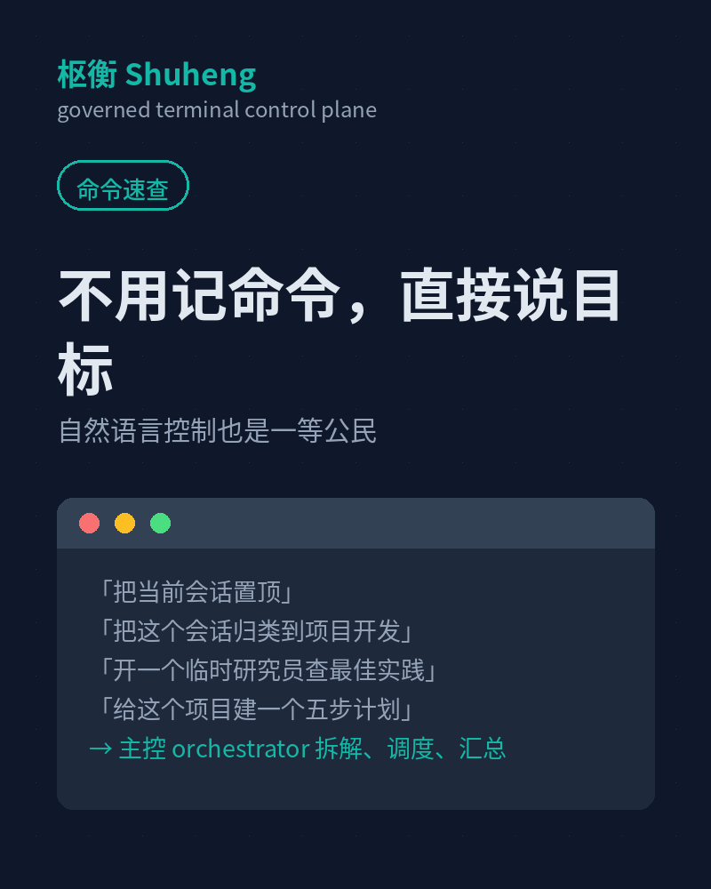

Shuheng 的定位一句话：**Runtimes execute. Shuheng governs the control surface.**

它不动底层 agent runtime，只把你每天真正接触的控制面做好 👇

## 会话工作区

- `/pin` `/unpin` 置顶重要会话
- `/category` 用「开发」「研究」「日常」「待处理」分类
- `/filter` 只看某一类
- `/archive` 归档暂时不用的会话
- `/delete` 删到回收站，不是直接没

长会话不再乱成一锅粥。

## 任务看板

复杂任务先拆步骤再推进，子 Agent 可以挂靠到具体步骤：

```text
任务：构建一个爬虫系统
1. 分析目标网站
2. 设计数据结构
3. 编写爬虫代码
4. 测试反爬策略
5. 输出文档与运行说明
```

`/tasks` 打开共享任务账本，主控 orchestrator 保留整体调度权。

## 治理视图

- `/approvals` 待审批事项，删除、Secret、长期记忆都要过审批门
- `/artifacts` artifact store
- `/evals` 启发式任务评估和 trace
- `/memory` 记忆系统可视化检查
- `/Secret` 本地加密 Secret Vault（xchacha20poly1305），`/lock` 锁定后清除明文状态



命令也不用硬背 —— 直接说「把这个会话归类到项目开发」「等子 Agent 返回后再汇总」就行。

刻意选了 Python curses 这种低依赖方案，避免复杂 UI 框架在部分终端 / Wayland / 鼠标模式组合下污染输入。稳，才能长期用。
